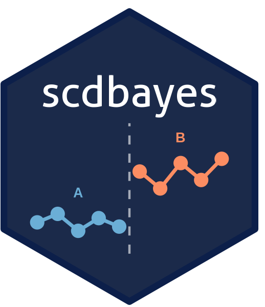

Bayesian multilevel modeling for single-case designs using
[brms](https://paulbuerkner.com/brms/) and
[Stan](https://mc-stan.org/). Fit piecewise regression models with
random effects, compute posterior-based effect sizes, and assess
consistency of effects across cases. Supports AB, reversal,
multiple baseline, multiple probe, alternating treatment, and changing
criterion designs. Handles two- to four-level hierarchical
structures for single-study and meta-analytic datasets.

## Installation

The development version from
[GitHub](https://github.com/mshin77/scdbayes) with:

    install.packages("devtools")
    devtools::install_github("mshin77/scdbayes")

## Load the scdbayes Package

    library(scdbayes)

## Alternatively, Launch and Browse the Shiny App

Access the web app at <https://www.scdbayes.org>.

Launch and browse the app on the local computer:

    run_app()

## Getting Started

See the [Single-Case
Design](https://mshin77.github.io/scdbayes/articles/single-case-design.html),
[Meta-Analysis](https://mshin77.github.io/scdbayes/articles/meta-analysis.html),
and [Power
Analysis](https://mshin77.github.io/scdbayes/articles/power-analysis.html)
articles.

## Citation

- Shin, M. (2026). *scdbayes: Bayesian single-case design analysis* (R
  package version 0.1.1) \[Computer software\].
  <https://mshin77.github.io/scdbayes>

- Shin, M. (2026). *scdbayes: Bayesian single-case design analysis*
  \[Web application\]. <https://www.scdbayes.org>
